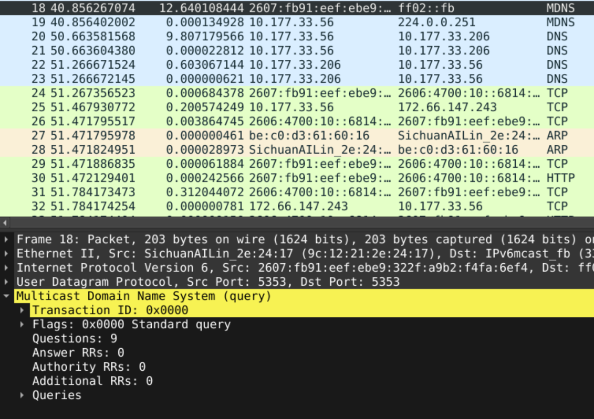

[← Back to Alex's Portfolio](https://github.com/AlexB-128)

# Network Analysis Lab

A hands-on lab focused on analyzing network traffic using Wireshark to observe how common network protocols operate, examine communication between devices, and develop practical packet analysis and network troubleshooting skills.

---

## DNS (Port 53) – Domain Name System

Performed an `nslookup` on google.com, wikipedia.com, and example.com.

The client requests Type A and AAAA records from the DNS server, which is also the default gateway in this example.

The DNS server replies to the client with the requested Type A and AAAA records.

The client chooses an ephemeral port to send its request from and uses the name server's DNS port (53). The name server then sends its reply/answer back to the source port of the client.

In this instance, a record is specifically requested because of the `nslookup` command. However, in the real world, DNS records are constantly being requested.

If you are trying to access a website in your web browser, when you type the website in and hit enter, your browser will check its DNS cache. If an existing record does not exist or has expired, your system will send a DNS query to the configured resolver.

The resolver will go through the iterative process of querying the:

- Root DNS server
- Top-Level Domain (TLD) server
- Authoritative Name Server

In order to receive an authoritative record of the hostname-to-IP mapping.

You can think of the Domain Name System much like a phonebook. We remember names and not numbers, so we have a service that connects what we know to where we want to go!


### DNS Requests


### DNS Responses


---

## MDNS (Port 5353) – Multicast Domain Name System

This allows your device to send out an mDNS packet to a multicast address.

Unlike traditional DNS, mDNS does not require a conventional DNS server. Instead, devices on the local network can send multicast queries and respond to requests for their own hostnames and services.

For example, this is what allows your device to discover a printer connected to your network. This is a device discovery method.

mDNS utilizes multicast addresses:

- IPv4: `224.0.0.251`
- IPv6: `ff02::fb`




---

## IPv4 Addressing / IPv6 Addressing

In the packets being sent, the IPv4 or IPv6 address is used to identify the source and destination.

Some things to look at when analyzing IP addressing:

- Source / Destination Addresses
- Protocol and Port #
- Source and Destination Ports / Ephemeral Ports
- Private / Public IP Addresses
- Multicast, Broadcast, and Unicast Addresses

IP addresses operate at the network layer, while TCP and UDP ports operate at the transport layer.


---

## UDP – User Datagram Protocol

**Layer 4 Protocol**

UDP is a connectionless protocol. There is no handshake involved, and it does not guarantee delivery, ordering, or retransmission of lost data.

UDP does include a checksum for detecting transmission errors, but it does not provide the same error recovery mechanisms as TCP.

If an application requires guaranteed delivery, UDP alone does not provide that functionality.

This protocol is excellent for real-time communications like video conferencing, VoIP, and online gaming, where minimizing latency is often important.


---

## TCP – Transmission Control Protocol

TCP is a connection-oriented protocol. In order to use this protocol to exchange data over a connection, the 3-way handshake must be performed and completed.

This Layer 4 transport layer protocol includes error checking, sequence numbers, retransmitting lost data, and acknowledgments when data arrives.

### 3 Way Handshake

**SYN → SYN/ACK → ACK**

This initiates the connection and allows communication to begin.

When there are issues during communication, TCP can send an RST to reset the connection. RST can also be used to abruptly terminate a connection.


### Connection Teardown

At the end of a conversation, a 4-way handshake is typically used to tear down the connection!

**FIN → ACK → FIN → ACK**

Sometimes FIN and ACK are combined into the same packet.


---

## HTTP – Hypertext Transfer Protocol

HTTP is a stateless application layer protocol. HTTP/1.1 typically uses TCP, while HTTP/3 uses QUIC over UDP.

When using HTTP over port 80, the data is not encrypted and can potentially be intercepted and read by someone in the middle.

After the user types a website address into the web browser, the requested domain name is queried in DNS. Once the Type A or AAAA record is returned, the connection can be made to the IP address of the website.

In this case, a TCP handshake was initiated:

**SYN → SYN/ACK → ACK**

This will result in the client's browser sending a "GET Request" to the web server.


The web server will reply with a `200 OK` status code.


In this case, the `curl` command was used to simulate this.

FIN/ACK packets are sent afterward to tear down the TCP connection.

---

## HTTPS – (TLS 1.3) Hypertext Transfer Protocol Secure / Transport Layer Security 1.3

HTTPS uses TLS to secure HTTP communication. In this example, HTTPS is using TCP over port 443. A TLS handshake is performed, and the server presents a certificate for authentication.

`https://www.google.com` was queried using the `curl` command.

The Type A and AAAA records were queried in DNS.

Those records were answered.

TCP 3-way handshakes were initiated with both IPv4 and IPv6.

Since IPv6 was able to establish a connection before IPv4, the IPv4 connection was torn down, and the rest of this communication took place over IPv6.

Using the TLS filter to view this communication in order.

### Cipher Suite

The TLS 1.3 cipher suite determines the encryption algorithm and hash algorithm used during the connection.

In this example, the server and client negotiated the `TLS_AES_256_GCM_SHA384` cipher suite.

- AES using a 256-bit encryption key – Encryption Algorithm
- Galois/Counter Mode (GCM) – Encryption mode that also provides authentication
- SHA-384 – Hash function used in the TLS key derivation process

The key exchange and authentication methods are negotiated separately from the TLS 1.3 cipher suite.

In this example, the connection also used:

- Pre-Shared Key (PSK) combined with ephemeral Diffie-Hellman key exchange.

### TLS Handshake

A simplified TLS 1.3 handshake:

```text
Client Hello ->
    (Supported Versions, Random Number, Cipher Suites, Extensions)

<- Server Hello
    (Selected Cipher Suite, Random Number, Key Share)

<- Encrypted Extensions

<- Certificate (if certificate authentication is used)

<- Certificate Verify

<- Finished

Client Finished ->

<- Encrypted Application Data -> 
```

1. The client sends a "Client Hello" and lists the cipher suites it supports, supported versions, and extensions, which are optional additional features added to TLS.

   

2. The server responds with a "Server Hello" and tells the client which cipher suite they will use based on the list the client provided.

   

3. The Change Cipher Spec message may still appear in TLS 1.3 for compatibility purposes. Unlike TLS 1.2, it does not perform the actual cryptographic state transition.

   

4. The application data is now encrypted using the negotiated encryption algorithm. Metadata can still be read, for instance, source/destination IP addresses and ports.

   

   

---

## ARP – Address Resolution Protocol

When a device is trying to discover another device's MAC address, it will send an ARP request.

The device has an IP address and needs to map it to a MAC address. When its question is answered, it will also store the mapping in its ARP table.

ARP Table:


In IPv6, ARP is not used. Instead, Neighbor Discovery Protocol (NDP) performs similar functions using ICMPv6.

---

## ICMPv6 (Internet Control Message Protocol for IPv6)

Two of the protocol's functions:

**Neighbor Solicitation** – Who has this IPv6 address? What's your MAC address?

**Neighbor Advertisement** – This is my IPv6 address, and here's my MAC address!

Neighbor Solicitation and Advertisement messages are used for address resolution and other Neighbor Discovery functions.


---

## ICMP (Internet Control Message Protocol)

### ICMP Ping

This is a diagnostic utility used to test if a device is reachable over the network.

In this demonstration, Google's Public DNS resolver at `8.8.8.8` responds to ICMP Echo Requests and was pinged using:

`ping -c 4 8.8.8.8`

- Echo Request
- Echo Reply


### Traceroute

Traceroute is also used for network diagnostics. It sends probes to the intended destination, starting with a TTL (Time to Live) value of 1 and incrementing it until the destination is reached.

As packets travel through routers, each router decrements the TTL. When the TTL reaches zero, the router typically responds with an ICMP Time Exceeded message.

This allows traceroute to identify the routers (hops) between the source and destination and measure the round-trip time of probes to each hop.

---

## Conclusion

This lab provided experience analyzing network traffic and understanding how different protocols communicate across a network.

Using Wireshark, I was able to observe DNS resolution, TCP handshakes, HTTP requests and responses, TLS negotiation, ARP, ICMP, and other network communications.

This helped me develop a better understanding of how network protocols operate, how devices communicate, and how packet analysis can be used for troubleshooting and investigating potentially abnormal network activity.

